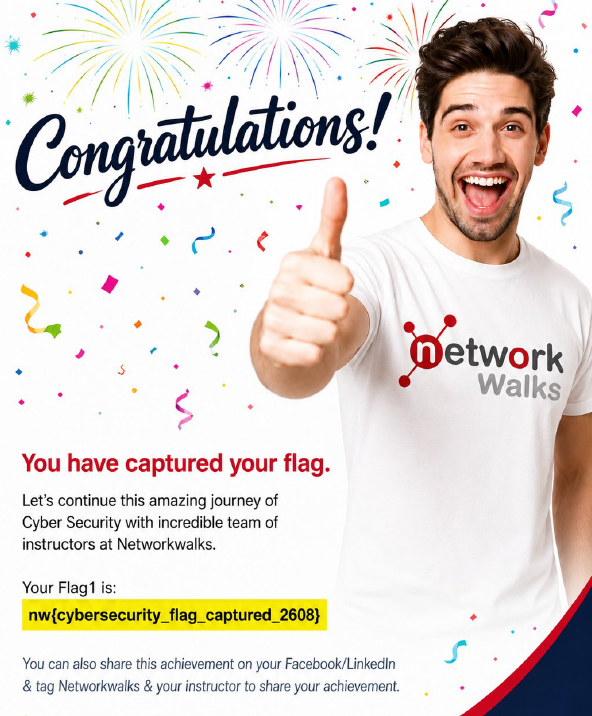
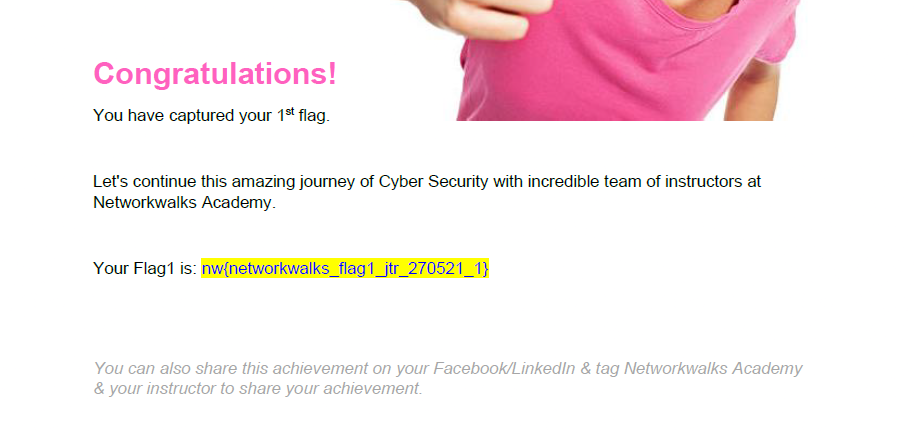
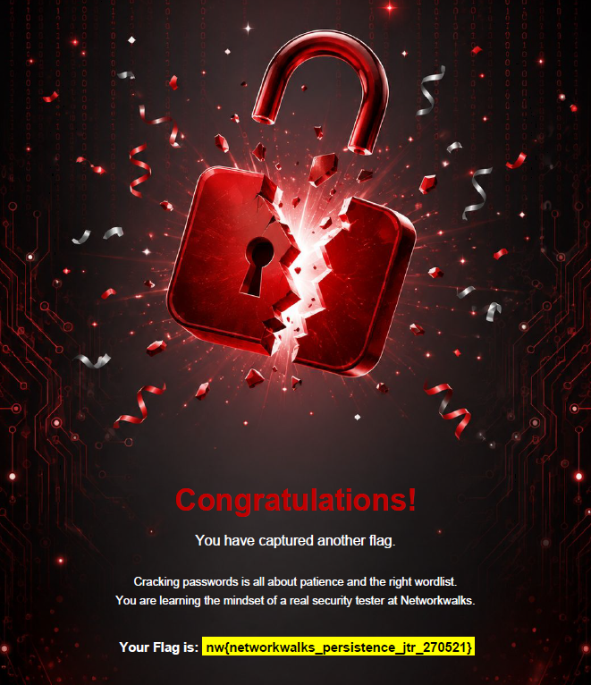
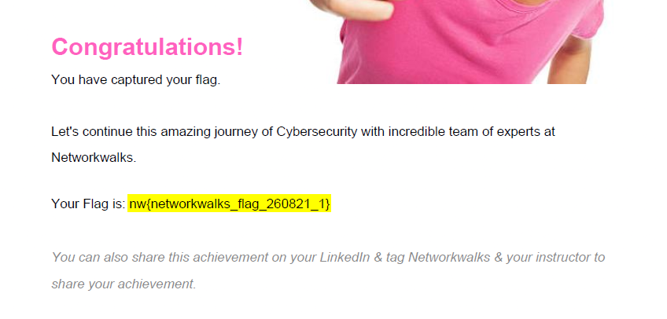

# 🔐 Password Cracking with John the Ripper & NetworkWalks Tools

Practical password recovery and password-strength testing using John the Ripper, Johnny, and NetworkWalks online tools.

---

## 📌 Project Overview

This project focuses on Password Cracking, as part of the Cybersecurity Program at NetworkWalks (Batch B084).

The practical exercises explore how password-protected files can be tested by extracting password hashes and using password-cracking tools to recover the original passwords.

The project consists of two modules:

1. **Password Cracking with John the Ripper (JTR)** – Using John the Ripper and its graphical interface, Johnny, to recover the password of a protected PDF file.
2. **Password Cracking with NetworkWalks Tools** – Using the NetworkWalks Hash Calculator and Password Cracker to extract a PDF hash and recover its password.

These exercises demonstrate how password-cracking techniques work and why using strong passwords is important for protecting sensitive files.

---

## 🎯 Objectives

The main objectives of this project are to:

- Understand the fundamentals of password cracking and password security.
- Understand the role of hashes in password-protected files.
- Extract password hashes from encrypted PDF files.
- Install and configure John the Ripper and Johnny.
- Use Johnny to load password hashes and perform cracking attacks.
- Use the NetworkWalks Hash Calculator to extract PDF hashes.
- Use the NetworkWalks Password Cracker to recover passwords.
- Verify recovered passwords by opening the protected PDF files.
- Understand the importance of strong passwords and responsible security testing.

---

## 🛠️ Tools & Technologies

| 🔧 Tool | 🎯 Purpose |
|---|---|
| John the Ripper (JTR) | Password-cracking tool used to recover passwords from supported hashes. |
| Johnny | Graphical interface for John the Ripper. |
| NetworkWalks Hash Calculator | Extracts password hashes from protected PDF files. |
| NetworkWalks Password Cracker | Attempts to recover passwords from extracted hashes. |
| OnlineHashCrack PDF Hash Extractor | Extracts password hashes from PDF files for the John the Ripper exercise. |
| Windows | Operating system used for the practical exercises. |
| Web Browser | Used to access the online password-cracking tools. |

---

## 🎯 Project Scope

The project covers two main areas:

### 1. Password Cracking with John the Ripper

Using John the Ripper and Johnny to recover the password of a protected PDF file.

Activities include:

- Downloading John the Ripper and Johnny.
- Configuring Johnny to locate the `john.exe` executable.
- Extracting the PDF password hash.
- Saving the extracted hash in a text file.
- Loading the hash into Johnny.
- Starting a password-cracking attack.
- Using the recovered password to open the PDF file.

### 2. Password Cracking with NetworkWalks Tools

Using NetworkWalks' online tools to extract and crack a PDF password hash.

Activities include:

- Downloading the protected PDF file from the lab page.
- Extracting its hash using the NetworkWalks Hash Calculator.
- Copying the complete hash value.
- Submitting the hash to the NetworkWalks Password Cracker.
- Waiting for the cracking process to finish.
- Using the recovered password to open the PDF file.

---

# 🪜 Practical Exercises

## Module 1. Password Cracking with John the Ripper (JTR)

### Step 1. Downloading John the Ripper and Johnny

Downloaded John the Ripper and Johnny for Windows.

- John the Ripper is the password-cracking engine.
- Johnny provides a graphical interface to interact with John the Ripper.

Resources:

- [John the Ripper – Official Website](https://www.openwall.com/john/)
- [Johnny – Official Website](https://openwall.info/wiki/john/johnny)

### Step 2. Configuring Johnny

After installing Johnny, the application was opened and configured to locate the `john.exe` executable.

The executable is located inside the `run` folder of the John the Ripper installation directory.

This configuration allows Johnny to use the John the Ripper engine when performing password-cracking attacks.

### Step 3. Extracting the PDF Hash

Downloaded the password-protected PDF file provided in the lab.

The PDF hash was extracted using the OnlineHashCrack PDF Hash Extractor:

[OnlineHashCrack – PDF Hash Extractor](https://www.onlinehashcrack.com/tools-pdf-hash-extractor.php)

After uploading the PDF file, the extracted hash was copied.

**Important:** The hash should start with `$pdf$`. Any unnecessary characters, such as `b'` at the beginning of the extracted value, should be removed before saving it.

### Step 4. Saving the Hash

Opened Notepad, pasted the extracted hash, and saved it as:

`hash1.txt`

This text file was then used as the input for Johnny.

### Step 5. Loading the Hash into Johnny

Opened Johnny and selected **Open password file**.

Browsed to the previously created `hash1.txt` file and loaded it into the application.

### Step 6. Starting the Password-Cracking Attack

Selected **Start new attack** to begin the password-cracking process.

John the Ripper attempted to identify the password associated with the supplied PDF hash.

The time required depends on the computer's performance and the complexity of the password.

### Step 7. Verifying the Recovered Password

After the password was recovered, the protected PDF file was opened and the recovered password was entered.

The PDF opened successfully, confirming that the password had been recovered.

---

## Module 2. Password Cracking with NetworkWalks Tools

### Step 1. Downloading the Protected PDF

Downloaded the encrypted PDF file (`My Locked PDF1.pdf`) from the NetworkWalks lab page:

[NetworkWalks – Password Cracking Lab](https://networkwalks.com/project-task-lab-password-cracking-with-networkwalks-tools/)

### Step 2. Extracting the PDF Hash

Opened the NetworkWalks Hash Calculator:

[NetworkWalks Hash Calculator](https://networkwalks.com/hash-calculator/)

Uploaded the protected PDF file.

The tool processed the file and generated its password hash.

### Step 3. Copying the Hash Value

Copied the complete extracted hash.

**Important:** The full hash value must be copied, starting from `$pdf$`, without missing any characters.

### Step 4. Opening the Password Cracker

Opened the NetworkWalks Password Cracker:

[NetworkWalks Password Cracker](https://networkwalks.com/password-cracker/)

### Step 5. Starting the Cracking Process

Pasted the extracted hash into the Password Cracker and started the attack.

The tool attempted different passwords until it found a matching password.

### Step 6. Recovering and Verifying the Password

Waited for the cracking process to finish and retrieved the recovered password displayed by the tool.

Opened the protected PDF file and entered the recovered password.

The PDF opened successfully, confirming completion of the exercise.

---

# 📸 Practical Evidence & Screenshots

The following screenshots show the success messages received after successfully cracking the passwords of the PDF files provided in the lab exercises.

They serve as evidence of successful password recovery during the practical work.

| Screenshot | Evidence |
|---|---|
|  | Successful password-cracking result |
|  | Successful password-cracking result |
|  | Successful password-cracking result |
|  | Successful password-cracking result |

---

# 💡 What I Learned

Through this project, I gained practical experience with several fundamental cybersecurity concepts.

### 1. Password Cracking Fundamentals

I developed a better understanding of how password-cracking techniques work and how security professionals use them to evaluate password strength.

### 2. Hash Extraction

I learned how to extract password hashes from protected PDF files and prepare them for password-cracking tools.

### 3. John the Ripper & Johnny

I gained practical experience installing and configuring John the Ripper, using Johnny as its graphical interface, loading password hashes, and starting cracking attacks.

### 4. NetworkWalks Password-Cracking Tools

I learned how to use the NetworkWalks Hash Calculator and Password Cracker to extract hashes and recover passwords through browser-based tools.

### 5. Password Verification

I learned the importance of verifying recovered passwords by using them to open the original protected files.

### 6. Password Security

I gained a better understanding of why password complexity matters and how weak passwords can expose protected files to unauthorized access.

---

# 🔐 Security & Ethical Considerations

Password cracking is a legitimate cybersecurity technique when performed within an authorized scope.

- Only test files and systems that you own or have explicit permission to assess.
- Never attempt to recover passwords from files without authorization.
- Handle extracted hashes and recovered passwords responsibly.
- Do not use password-cracking techniques to gain unauthorized access.
- Follow applicable laws and ethical security-testing guidelines.

**Important:** The exercises in this project were performed on PDF files provided specifically for the NetworkWalks training labs.

---

# 🔗 Tools & Resources

- [NetworkWalks](https://networkwalks.com/)
- [John the Ripper](https://www.openwall.com/john/)
- [Johnny GUI](https://openwall.info/wiki/john/johnny)
- [OnlineHashCrack PDF Hash Extractor](https://www.onlinehashcrack.com/tools-pdf-hash-extractor.php)
- [NetworkWalks Hash Calculator](https://networkwalks.com/hash-calculator/)
- [NetworkWalks Password Cracker](https://networkwalks.com/password-cracker/)
- [NetworkWalks Password Cracking Lab](https://networkwalks.com/project-task-lab-password-cracking-with-networkwalks-tools/)

---

**NetworkWalks – Cybersecurity Program | Batch B084**
